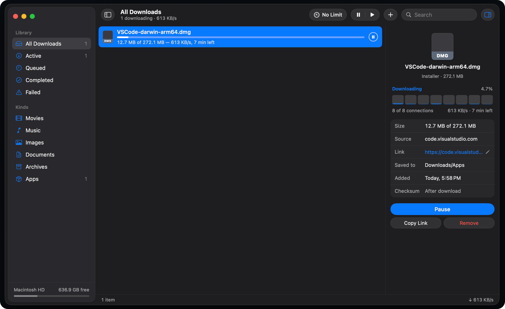

# Haul

A native download manager for macOS, built with SwiftUI.

## Features

- Multi-connection downloads that pause and resume, including across relaunches
- A queue you can reorder, with a limit on simultaneous downloads
- Speed limit, a nightly download schedule, and pausing on Personal Hotspot
- The system proxy, or a custom HTTP or SOCKS5 proxy with sign-in and a list of hosts that skip it
- Automatic retries, and fresh links for expired downloads (Update Link)
- Sorting into folders by kind, duplicate detection, SHA-256 checksums
- Extracting zip, tar and 7z archives, then opening or showing the result in Finder, when they finish
- Menu bar progress, Dock progress, and notifications
- Links from other apps through Services → Download with Haul, or `haul://add?url=<encoded link>`
- A `haul` command: `haul add <link>…` opens the links in the Add panel (Haul → Install Command Line Tool…)
- A Safari extension: right-click a link and choose Download with Haul (turn it on in Safari → Settings → Extensions). Links download signed in, with Safari's cookies for the site
- A Chrome and Firefox extension (also Brave, Edge, Vivaldi and Arc) that hands the browser's downloads to Haul and adds Download with Haul to the menu for links. Load the `BrowserExtension` folder as an unpacked extension; Haul registers itself with the browsers when it launches
- Haul in the Share menu for web links (turn it on from the Share menu’s Edit Extensions)
- Keyboard shortcuts for the selected download, listed in Help → Keyboard Shortcuts

## Install

Requires macOS 26 or later on Apple Silicon.

1. Download `Haul-<version>.dmg` from the [latest release](https://github.com/sibiraj-s/haul/releases/latest).
2. Open it and drag Haul to Applications.

Haul checks for updates once a day and installs them from within the app.
