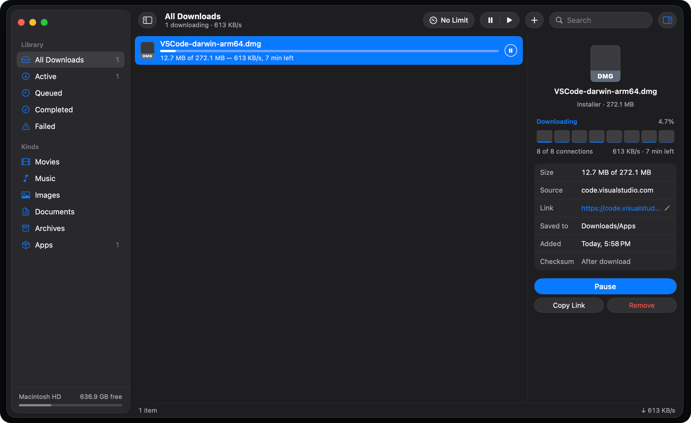

# Haul

A native download manager for macOS, built with SwiftUI.

**[Download for macOS](https://github.com/sibiraj-s/haul/releases/latest)** · [Chrome extension](https://chromewebstore.google.com/detail/dhpcpomodjoajhnpnbnobdngljjilfge) · [Firefox add-on](https://addons.mozilla.org/firefox/addon/haul-downloader/) · [Website](https://haul.sibiraj.dev)

## Features

- Multi-connection downloads that pause and resume, even across relaunches
- A reorderable queue with a limit on simultaneous downloads
- Speed limit, a nightly download schedule, and pausing on Personal Hotspot
- The system proxy, or a custom HTTP or SOCKS5 proxy with sign-in and hosts that skip it
- Automatic retries, and Update Link for expired downloads
- Sorting into folders by kind, duplicate detection, and SHA-256 checksums
- Extracting zip, tar and 7z archives when they finish, then opening or showing the result in Finder
- Menu bar progress, Dock progress, and notifications
- Keyboard shortcuts for the selected download (Help → Keyboard Shortcuts)

## Adding downloads

- **Chrome and Firefox** (also Brave, Edge, Vivaldi and Arc): the [Chrome](https://chromewebstore.google.com/detail/dhpcpomodjoajhnpnbnobdngljjilfge) or [Firefox](https://addons.mozilla.org/firefox/addon/haul-downloader/) extension hands the browser's downloads to Haul and adds Download with Haul to the menu for links. Haul registers itself with the browsers when it launches.
- **Safari**: the extension that comes with the app adds Download with Haul to the menu for links, and downloads them signed in with Safari's cookies. Turn it on in Safari → Settings → Extensions. Safari doesn't let extensions take over its downloads, so downloads you start in Safari stay in Safari.
- **Share menu**: Haul appears for web links (turn it on from the Share menu's Edit Extensions).
- **Services**: Download with Haul, from any app.
- **URL scheme**: `haul://add?url=<encoded link>`
- **Command line**: `haul add <link>…` opens the links in the Add panel. Install it from Haul → Install Command Line Tool….

## Install

Requires macOS 26 or later on Apple Silicon.

1. Download `Haul-<version>.dmg` from the [latest release](https://github.com/sibiraj-s/haul/releases/latest).
2. Open it and drag Haul to Applications.

Haul checks for updates once a day and installs them from within the app.
